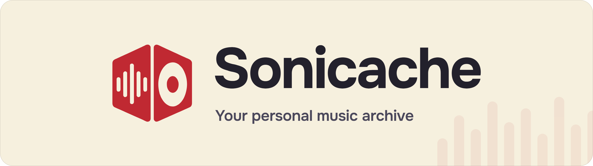
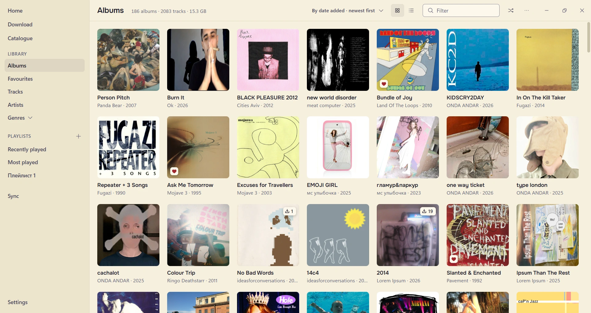
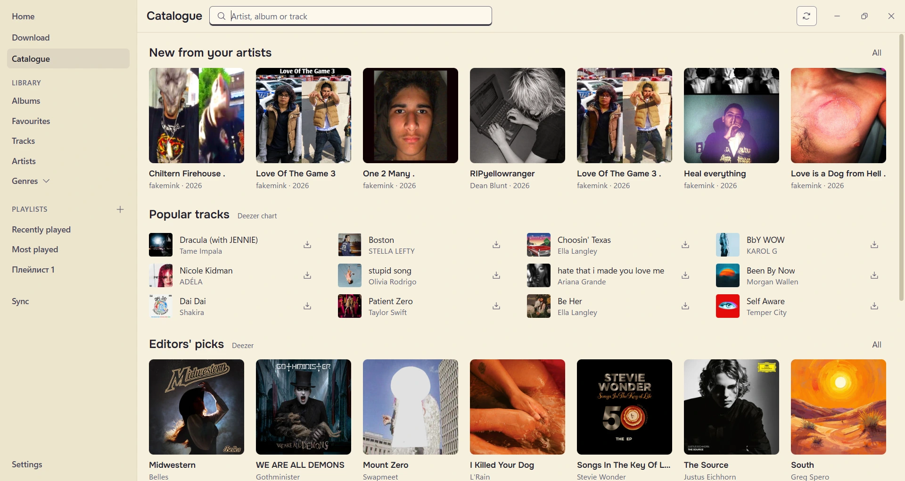
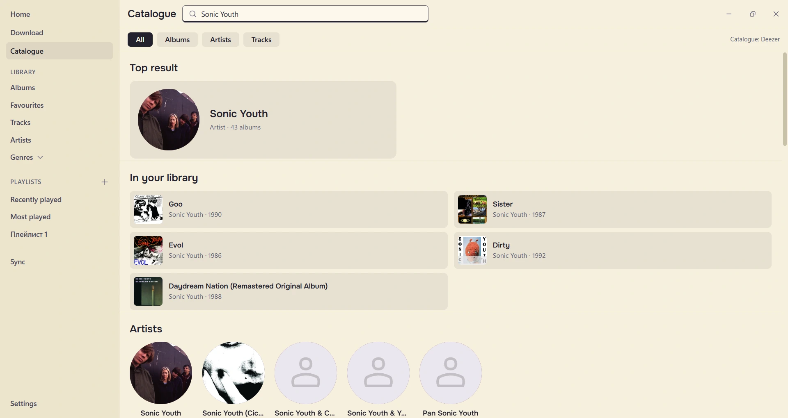

<div align="center">

<!-- A picture and not a heading: GitHub draws a rule under a heading, and the banner carries the name itself -->
<picture>
  <source media="(prefers-color-scheme: dark)" srcset="docs/banner-dark.png">
  
</picture>

Paste a link or type an album's name, and it lands in your folder tagged,<br>
with the cover, the genre and the lyrics.

[](https://github.com/mojave333/sonicache/actions/workflows/ci.yml)
[](https://github.com/mojave333/sonicache/releases/latest)
[](LICENSE)

[Download](#download) &nbsp;·&nbsp; [iPod](#ipods) &nbsp;·&nbsp; [When something breaks](#when-something-breaks)

</div>

---

Sonicache runs on your own computer, with no accounts and no API keys. It works on Windows, macOS and Linux,
in Russian or English.

<br>

<p align="center">
  <a href="docs/library.webp"></a>
  <br>
  <sub><b>Library</b> &nbsp;·&nbsp; everything in your music folders, newest first, with favourites, playlists and genres on the side</sub>
</p>

<br>

<p align="center">
  <a href="docs/catalogue.webp"></a>
  <br>
  <sub><b>Catalogue</b> &nbsp;·&nbsp; new releases from the artists you have, the Deezer chart and editors' picks</sub>
</p>

<br>

<p align="center">
  <a href="docs/search.webp"></a>
  <br>
  <sub><b>Search</b> &nbsp;·&nbsp; Sonic Youth, and the five of their albums already in the library</sub>
</p>

<br>

## What it does

- Takes links from Spotify, Apple Music, Deezer, Last.fm, YouTube, SoundCloud and Bandcamp, or just a name
  such as "Daft Punk - Discovery". Whole playlists come too, up to 1000 tracks.
- Looks each track up by its recording code (ISRC) where there is one, so the file is the same recording the
  service lists. A track it cannot find is reported as missing, and nothing else is saved in its place.
- Saves MP3 at 320 kbit/s by default, or M4A, or Opus as YouTube streams it.
- Keeps a library of every music folder you add, including music it didn't download, and fills in the
  covers, genres and lyrics older albums lack.
- Plays it all: gapless albums, crossfade, an equalizer, synced lyrics on screen.
- Searches a catalogue, shows new releases from the artists you have and checks watched playlists twice a
  day for new tracks.
- Copies your music to a player, an SD card, an Android phone or a classic iPod, and lets a phone play the
  library over Wi-Fi in a Subsonic app such as Amperfy or Ultrasonic.

## Download

Get the latest version from [Releases](https://github.com/mojave333/sonicache/releases/latest). Everything
the program needs is inside, so there is nothing else to install.

| System | File | Or |
|---|---|---|
| Windows 10 and 11 | `…-windows-x64-setup.exe`, or the `.zip` to run without installing | `scoop bucket add sonicache https://github.com/mojave333/sonicache`<br>`scoop install sonicache/sonicache` |
| macOS, Apple Silicon | `…-macos-arm64.dmg` | `brew tap mojave333/sonicache https://github.com/mojave333/sonicache`<br>`brew install --cask mojave333/sonicache/sonicache` |
| macOS, Intel | `…-macos-x64.dmg` | the same Homebrew commands |
| Linux, 64-bit | `…-linux-x64.tar.xz`: unpack it and start `Sonicache` | |

On Windows the program updates itself. On macOS and Linux the settings tell you when a new version is out.

<details>
<summary><b>Windows says it protected your PC, or the antivirus took the file</b></summary>
<br>

The program isn't signed with a paid certificate. In the blue SmartScreen window click "More info", then
"Run anyway".

Windows Defender sometimes flags `Sonicache.exe` as `Trojan:Win32/Sabsik.EN.D!ml`. That is a false alarm it
raises for many programs packed the same way. Open Windows Security → Protection history, pick the
Sonicache entry, choose "Allow on device", and unpack the archive again.

</details>

<details>
<summary><b>macOS won't open the app</b></summary>
<br>

The app isn't signed by Apple, so the first launch is blocked. Open System Settings → Privacy & Security,
scroll down to Sonicache and click "Open Anyway". Or run this once in Terminal:

```sh
xattr -dr com.apple.quarantine /Applications/Sonicache.app
```

</details>

<details>
<summary><b>Linux: the window doesn't open</b></summary>
<br>

You need glibc 2.35 or newer (Ubuntu 22.04, Debian 12, Fedora 36 or later). Start `./Sonicache/Sonicache`
from a terminal, and it will name the library it is missing.

</details>

## iPods

Turn on disk mode, plug the iPod in, and it shows up on the Sync page. Sonicache writes the iPod's own
database, so the songs appear under Music → Artists, Albums and Playlists, and whatever iTunes put there
stays. Opus and FLAC files are converted to MP3 on the way.

| iPod | Works | Covers |
|---|---|---|
| iPod 1st to 4th generation, iPod mini | yes | no, the screen has no colour |
| iPod photo / color | yes | yes |
| iPod video (5th and 5.5th generation) | yes | yes |
| iPod nano 1st and 2nd generation | yes | yes |
| iPod nano 3rd and 4th generation | yes | yes |
| iPod Classic (6th, 6.5th and 7th generation) | yes | yes |
| iPod nano 5th, 6th and 7th generation | no, only iTunes can sign their database | |
| iPod shuffle | no | |
| iPod touch | no, use the library over Wi-Fi instead | |

An iPod running Rockbox is synced like any other player, as plain folders.

> [!NOTE]
> The iPod Classic and the covers haven't been tried on a real iPod yet. If something looks wrong after a
> sync, please [open an issue](https://github.com/mojave333/sonicache/issues) and say which model it is.

## If a service is blocked

Sonicache connects from your computer, so it sees what your network lets through. Settings → Network →
"Check" shows what opens.

In Russia, where YouTube is slowed down and Spotify does not work, run [Zapret](https://github.com/bol-van/zapret)
or a VPN. Zapret works for the whole computer, so Sonicache needs no setting for it. So does a VPN in TUN or
"system proxy" mode. If your VPN app only opens a local proxy (v2rayN, Clash, Hiddify and the like), "Check"
finds it, and one click puts it to use.

When Spotify won't show a release to your network, the program reads it through its own relay abroad, with
nothing for you to set up.

## When something breaks

Go to Settings → If something does not work → "Copy the report", and paste it into an
[issue](https://github.com/mojave333/sonicache/issues). Errors from YouTube usually go away after updating
to the newest version.

## Licence

[GPL-2.0-or-later](LICENSE). The Linux build includes Qt and PyQt6, so that build as a whole is GPL-3.0.

Please use Sonicache only for music you have the rights to, and respect the terms of the services involved.
